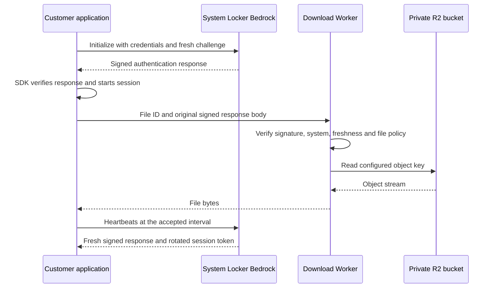

# Bedrock + Cloudflare R2

### Authenticated downloads from a private bucket

A small Cloudflare Worker that verifies **System Locker Bedrock** signed responses before streaming allowlisted files from a private R2 bucket. Bedrock handles licensing and sessions. The Worker handles file authorization and delivery.

This is an independent integration, not an official System Locker or Cloudflare SDK. It is unrelated to Amazon Bedrock.

## What it does

- Verifies Ed25519 signatures over the original payload bytes before parsing JSON.
- Pins trusted public keys and checks the signed system ID and `bedrock-v1` protocol.
- Requires an authorizing response, consistent flags, session token, signing key ID and recent timestamp.
- Maps public file IDs to fixed private object keys. Clients cannot choose arbitrary bucket paths.
- Supports optional per-file entitlements from signed server-side variables.
- Allows `OUTDATED` only for files explicitly configured to accept it.
- Streams R2 content with cache prevention. No R2 credentials are sent to clients.
- Includes Node.js download tooling, a C++ SDK transport adapter, tests and GitHub Actions.

## Architecture



The application continues to own its Bedrock session and heartbeat scheduling. The Worker does **not** call `/beat`, rotate tokens, or require the customer's license key or password. Never run competing heartbeat loops for one session.

## Requirements

- A System Locker system with Bedrock production access, its system ID and trusted Ed25519 public key.
- A Cloudflare account with Workers and R2 enabled.
- Node.js 22 or newer and npm for development and deployment.
- An application that retains the **original base64url Bedrock response body** after its SDK verifies authentication.

The signed transport is `base64url(signature[64 bytes] || original JSON bytes)`. Sending only `session_token`, decoded JSON, or a re-serialized payload will not work.

## Deploy

### 1. Install and test

```sh
npm ci
npm run check
npm run build
npx wrangler login
```

`build` is a dry run; it does not deploy anything.

### 2. Create a private bucket

```sh
npx wrangler r2 bucket create bedrock-private-files
```

Keep the bucket's **Public Development URL disabled** and do not attach a public custom domain to the bucket. A custom domain on the **Worker** is fine. If you use a different bucket name, change `r2_buckets[0].bucket_name` in `wrangler.jsonc`.

Upload your own release artifact:

```sh
npx wrangler r2 object put bedrock-private-files/releases/app-1.0.0.zip --file ./app-1.0.0.zip --remote
```

Use `--remote` for production uploads; local Wrangler storage is separate.

### 3. Configure trust and file access

Copy `config.example.json` to `config.json`. Set:

| Setting | Meaning |
| --- | --- |
| `system` | Your 20-character hexadecimal Bedrock system ID |
| `publicKeys` | One to three trusted raw 32-byte Ed25519 public keys, base64url encoded |
| `maxProofAgeSeconds` | Maximum signed proof age; default example 60 seconds, allowed range 1–300 |
| `futureClockSkewSeconds` | Allowed future timestamp skew; default example 5 seconds, maximum 30 |
| `files` | Explicit file-ID-to-object mapping |
| `key` | Exact R2 object key, configured by you |
| `downloadName` | Safe filename returned to the customer |
| `allowOutdated` | Whether an authenticated `OUTDATED` response may download this file |
| `requiredVariable` | Optional exact string match against a signed Bedrock variable |

Delete example file entries you do not need. An entry without `requiredVariable` is available to **any valid authenticated proof for this system**. This is not per-license file access unless you configure an entitlement.

Obtain the public key from your trusted System Locker dashboard. Do not obtain a verification key from the request being verified. The example intentionally contains an invalid placeholder key and fails closed until configured.

Upload the configuration as a Worker secret:

```sh
npx wrangler secret put GATEWAY_CONFIG
```

Paste the full contents of `config.json` when prompted. The public signing key is not a private key; using a secret here also keeps operational file mappings out of the public repository. `config.json` and `.dev.vars` are gitignored.

### 4. Publish the Worker

```sh
npm run deploy
```

Wrangler prints the Worker URL. If deployment creates the Worker before you set the secret, all download requests return `503` until configuration exists. Deploying this repository does not modify any existing bucket or Worker unless you deliberately configure the same resources.

## Download API

```http
POST /v1/download/app-package
Content-Type: text/plain

<original signed base64url Bedrock response body>
```

The proof goes in the request body, not in a URL or query parameter. HTTPS is required except on localhost for development. Request body limit: 64 KiB, including streamed bodies without a Content-Length header. Large Bedrock variable sets may exceed this limit; request only needed variables.

Success returns `200`, an `application/octet-stream` body, attachment filename, content length and ETag. The ETag is an object identifier, **not** a trusted SHA-256 release signature. Every response has `Cache-Control: private, no-store`; the Worker does not use the Cache API. Do not put a cache-everything rule in front of the endpoint.

| Status | Meaning |
| --- | --- |
| 400 | Invalid request shape, query parameters, insecure transport or unsupported range |
| 401 | Missing/invalid/stale authentication proof |
| 403 | File entitlement missing or update required |
| 404 | Unknown file ID, route or missing R2 object |
| 405 | Use POST |
| 413 | Proof exceeds the body limit |
| 415 | Use `Content-Type: text/plain` |
| 500 | Internal failure; details are not exposed |
| 503 | Missing or invalid server configuration |

GET, HEAD, range requests and conditional downloads are intentionally not implemented. This is a native-client endpoint; no cross-origin browser access is enabled.

### Runnable Node.js download client

For a manual test, save the original verified response body to a local `proof.txt` and download immediately:

```sh
node examples/download.mjs https://YOUR-WORKER.workers.dev app-package proof.txt app.zip
```

The client streams to a unique temporary file and renames only after the transfer completes. It rejects redirects and does not execute or install downloaded content. The output path is chosen by you; an existing output may be replaced on platforms that allow it. Keep proof files out of Git and remove them after testing. In a real app, keep proofs in memory.

### C++ application integration

Use the official Bedrock SDK for authentication. `examples/proof_transport.hpp` is an original adapter around its `IHttpClient` that captures raw responses in memory. Wrap the transport before constructing the SDK client:

```cpp
#include <syslocker/bedrock.hpp>
#include "proof_transport.hpp"

// Fill config with your existing system, public key, HWID and version settings.
auto transport = std::make_unique<ProofTransport>(
    syslocker::bedrock::makeCurlHttpClient());
auto* captured = transport.get();
syslocker::bedrock::Client client(config, std::move(transport));

auto auth = client.authenticateWithKey(license);
if (!auth || !auth->sessionStarted)
    return 1;

const std::string proof = captured->snapshot();
// POST proof as text/plain to /v1/download/app-package using your HTTPS client.
// The Node example above demonstrates the complete gateway download request.
```

The adapter is not an authentication decision: only the SDK's verified result and the Worker's independent checks authorize access. It records only the configured Bedrock init/beat URLs; clear it and stop protected work on heartbeat failure. It delegates GET requests unchanged, so existing Invisible Folder support remains available. This repository does not bundle the SDK or claim a drop-in patch for a custom application wrapper.

For a later download, use a fresh response from the application's **normally scheduled** heartbeat. Do not call heartbeat early merely to get a new proof. Match your proof-age window to the accepted heartbeat interval, or accept that downloads must wait for a fresh scheduled heartbeat. The reference default 30-second heartbeat fits the example 60-second proof window.

## Optional file entitlements

The `premium-content` example requires the signed variable `download_tier` to equal the string `premium`. Request that variable during Bedrock initialization using the SDK's initialization options. Missing variables, `false`, booleans and other strings do not grant access.

Configure that variable's real authorization policy in System Locker. A static variable returned identically to every authenticated user does **not** create separate license tiers. The gateway trusts only the signed value, never a client-supplied claim.

## Updates and release publication

`OUTDATED` is still an authenticated Bedrock response. This Worker accepts it only for file entries with `allowOutdated: true`. For that response, Bedrock's signed `is_error` is true while `authed` is true and `is_failure` is false.

An **unauthenticated public updater** is a separate route/bucket/design; this repository does not turn protected files public. For protected releases:

1. Upload the new artifact under a versioned object key.
2. Verify the upload and release signature/hash through your release process.
3. Change the logical file mapping in `config.json` and update `GATEWAY_CONFIG`.
4. Coordinate any required Bedrock application-version changes afterward.
5. Keep the old object until rollback is no longer needed.

A download already in progress is not actively revoked. Validate your own signed release manifest or code signature before installing/executing downloads. The sample client completes transfer but does not implement installation or automatic executable replacement.

## Security model and limits

The signed response is a **short-lived bearer proof** at this gateway. Anyone who possesses it can replay it until its age exceeds the configured limit. The signed challenge is checked for shape but is not a Worker-issued nonce; this gateway did not observe the original authentication request. Sending the same challenge separately would not add replay protection.

This implementation proves recent successful authentication, not current session liveness. Revoking a license or terminating a session does not invalidate an already issued proof instantly. Future timestamp allowance can extend acceptance slightly. Revocation/key removal takes effect at the gateway after configuration propagation; existing streams are not cancelled.

For stronger request binding or single-use access, add a Worker-issued challenge and transactional replay storage, or design an online authorization exchange. Do not describe this stateless implementation as replay-proof, device-bound, or instantly revocable. A signed HWID claim alone cannot prove which device is making the download request.

The proof contains a session token. Treat the entire body as a credential. Do not log it, include it in analytics, send it to third-party tracing or put it in public bug reports. TLS certificate validation must stay enabled. Request size limits are not rate limiting: configure Cloudflare rate limiting appropriate to your plan and traffic before broad production use. No built-in request quota is claimed.

One Worker configuration serves one system. Use separate deployments/bucket prefixes for different products; do not let the client choose the trusted system or public key. Up to three explicitly configured keys allow a controlled rotation window. Remove old keys when the migration period ends.

The Worker deliberately does not trust an unsigned transport header as authorization. It pins keys and checks signed `protocol_version` and `kid`; the application SDK still performs its full header/challenge/identity validation. No customer credentials, management tokens, R2 access keys or signing private keys belong in this repository.

## Local development and tests

```sh
node scripts/local-config.mjs
npm run dev
```

The script converts your configured `config.json` into an ignored `.dev.vars` file. Local Wrangler uses local R2 storage unless you explicitly enable a remote binding.

```sh
npm run check
npm run build
```

Tests generate ephemeral Ed25519 keys and synthetic signed responses, exercise authorization and rejection cases, and use a fake R2 binding. They do not contact Bedrock or your production bucket. `npm run test:runtime` runs a separate local Workers-runtime smoke test that checks the built Worker with a local R2 binding. Live deployment acceptance still requires your actual Bedrock account, public key and bucket.

## Protocol references

Field names and transport behavior were checked against the official C++ reference at commit `43434bb1210348d26ccff7cce984229806e8a0ab`; this repository is an independent implementation and does not redistribute its source.

- [System Locker Bedrock documentation](https://systemlocker.net/documentation/bedrock)
- [Official C++ protocol verification](https://github.com/systemlocker/System-Locker-Bedrock-CPP/blob/43434bb1210348d26ccff7cce984229806e8a0ab/src/crypto.cpp)
- [Official C++ HTTP transport interface](https://github.com/systemlocker/System-Locker-Bedrock-CPP/blob/43434bb1210348d26ccff7cce984229806e8a0ab/include/syslocker/bedrock/http.hpp)
- [Cloudflare R2 Workers binding](https://developers.cloudflare.com/r2/api/workers/workers-api-usage/)
- [Cloudflare R2 API reference](https://developers.cloudflare.com/r2/api/workers/workers-api-reference/)

## License

MIT. See [LICENSE](LICENSE).
